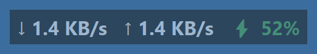
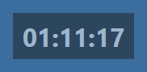

# battery-overlay

Small always-on-top overlays for Windows, written in Python/tkinter:

- **Top-right:** real-time network download/upload speed and battery percentage
  (green > 50%, yellow > 20%, red below; ⚡ while charging)
- **Top-left:** digital clock





The overlays are semi-transparent and **click-through**: mouse clicks go to the
windows behind them, they never take focus, and they don't show up in the
taskbar or Alt+Tab.

## Requirements

- Windows
- Python 3.8+
- [psutil](https://pypi.org/project/psutil/)

```bash
pip install psutil
```

## Run

```bash
pythonw battery_overlay.py
```

Running it again while the overlays are shown **closes them**, so the same
command (or shortcut) works as an on/off toggle.

`pythonw` runs without a console window and hides errors. Use
`python battery_overlay.py` if something doesn't show up.

## Desktop / Start Menu shortcut

Create a shortcut (on the Desktop, in the Start Menu, or in `shell:startup` to
start at login) with:

- **Target:** `"C:\path\to\pythonw.exe" "C:\path\to\battery_overlay.py"`
- **Start in:** the folder containing `battery_overlay.py`
- **Icon:** `icon.ico` from this repo

Click it once to show the overlays, click it again to hide them.

## Settings

Edit the constants near the top of `battery_overlay.py`:

| Setting | Default | Meaning |
|---|---|---|
| `ALPHA` | `0.5` | Opacity, `0.0` invisible to `1.0` opaque |
| `MARGIN` | `0` | Distance from screen edges in pixels |
| `CLOCK_FORMAT` | `"%H:%M:%S"` | Clock format, e.g. `"%H:%M"` or `"%I:%M %p"` |
| `REFRESH_MS` | `1000` | Battery and network update interval |
